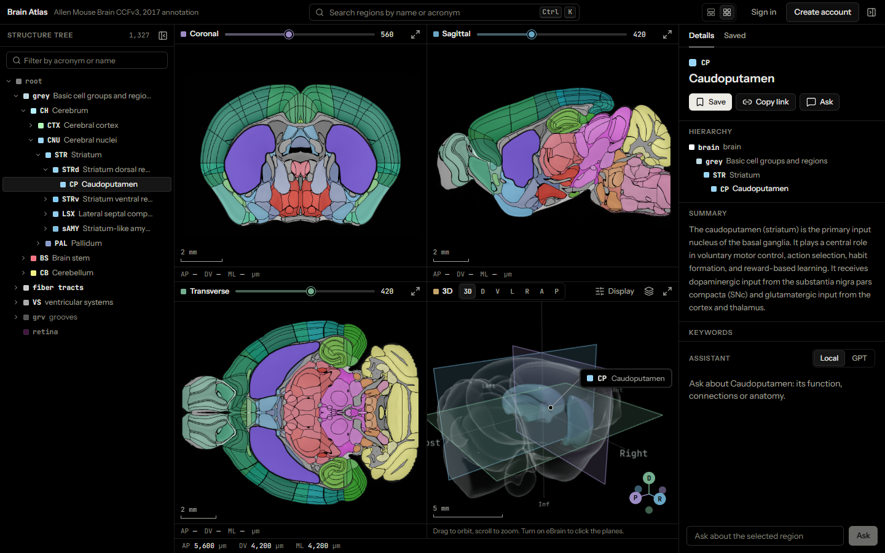
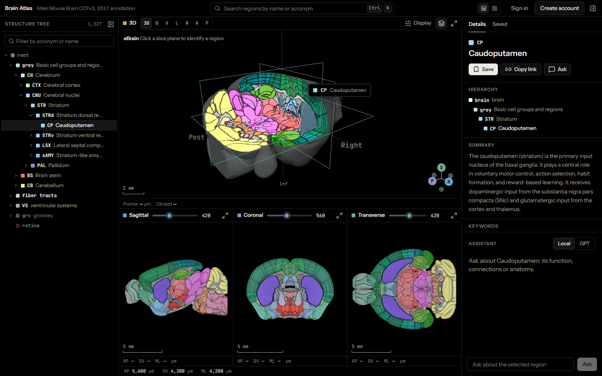
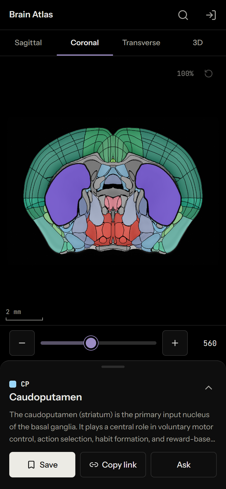
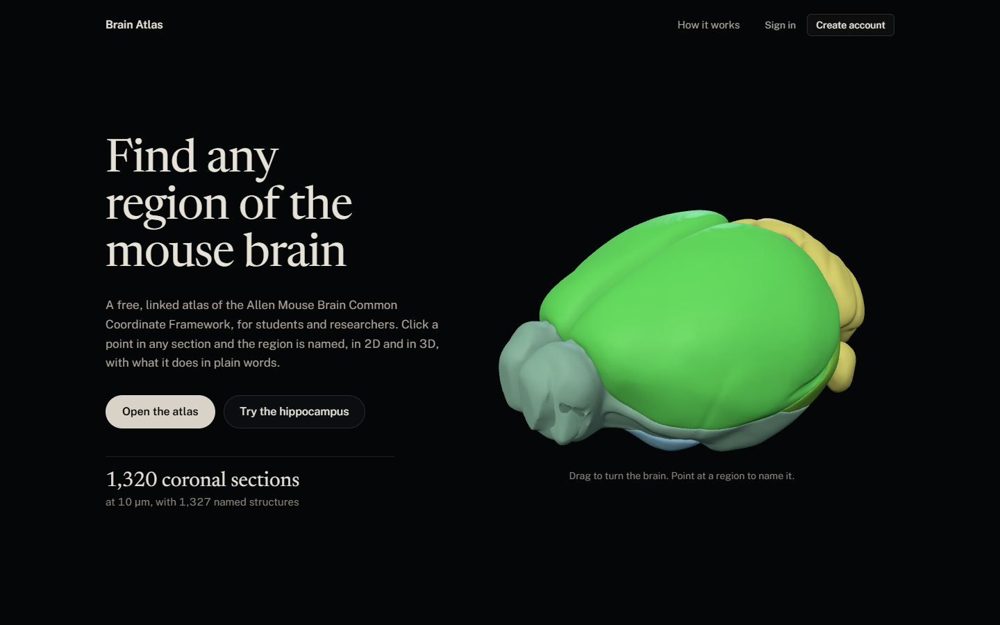

# Brain Atlas

A web atlas of the Allen Mouse Brain Common Coordinate Framework (CCFv3, 2017 annotation). Click any point in a section and the app names the region there, moves the other sections to it and shows it in 3D.



## Overview

The Allen CCFv3 is a shared 3D reference space for the mouse brain: 1,320 coronal sections at 10 µm, with 1,327 named structures. The data is public but hard to browse without specialist tools. This app puts the annotated volume in a browser as three linked section planes and a 3D model, so you can go from "what is this?" or "where is X?" to an answer in a few clicks.

It was built with students in mind, people learning neuroanatomy who don't yet know the acronyms. Researchers can use it to find a region quickly, read its coordinates in µm and send a link to the exact view.

The app has two pages. The home page at `/` has a 3D brain you can turn, with each major division in its Allen colour. The atlas itself is at `/app`.

## Features

### Linked sections and 3D

- Sagittal, coronal and transverse sections of the annotated volume, coloured by region. Clicking a pixel identifies the region under it and moves the other two sections to that point.
- Each section zooms toward the cursor (wheel or pinch) and pans by dragging. The footer of each view shows the pointer's position as AP, DV and ML in µm.
- The 3D view shows the selected structure's mesh inside a translucent brain, with the three section planes where the 2D views sit. Camera buttons jump to standard views (dorsal, ventral, left, right, anterior, posterior).
- Two layouts, switched in the top bar and remembered per browser: Stage (3D above a strip of the three sections) and Four views (a 2×2 grid). Any view can be expanded to fill the space.
- The Display menu turns the brain outline, section planes and axis labels on or off and sets surface opacity. The eye button next to a structure in the tree adds its surface to the 3D view.

### eBrain mode

eBrain paints the three planes with region colours taken from a 3D label volume built from the meshes, and cuts away the octant facing the camera so you can see where the planes cross. Hovering a plane highlights the region under the pointer and shows its position; clicking selects that region in every view.



### Finding regions

- Search by name or acronym (Ctrl K or `/`). Results include whole groups as well as single structures: searching "thalamus" offers the thalamus as one group of 51 regions, next to its subdivisions.
- The structure tree on the left is the complete Allen hierarchy, with its own filter box.
- Every way of opening a region (a click, search, the tree, a saved item or a link) moves all four views to it. If two answers arrive out of order, the newer one wins.

### What isn't in the atlas

The Allen ontology names more structures than the annotation volume draws, and not every structure has its own mesh. The tree greys out structures with no voxels, search marks them "Not shown in the 2D atlas", and when a structure has no 3D mesh the view shows its nearest ancestor that has one and says so.

### Region details

The right panel shows the selected region's acronym, ID and hierarchy (each level in its Allen colour), followed by a summary, keywords, related regions, facts about the reference atlas, and the citation. Summaries come from a small hand-written knowledge base (`backend/brain_regions_kb.json`, 8 regions so far) or, with an OpenAI key, are generated once per region and cached.

### Assistant

The assistant answers questions about the selected region, or general questions when nothing is selected. You pick the model per question:

- Local runs on your own machine through [Ollama](https://ollama.com) (`gemma3:4b` by default). It is given the atlas's own facts about the region and the curated notes where they exist, and can draw on [CortexMap](https://capstone.ssdd.dev), a separately hosted literature service, when it is reachable.
- GPT uses OpenAI.

When an answer lists regions, they appear as chips that open the region in the atlas. Literature sources show up as links to PubMed Central.

### Links, accounts and phones

- The address bar always holds the selected region and the three slice positions (`/app?region=662&sag=420&cor=560&tra=420`), so copying the URL shares the exact view. The Copy link button does the same.
- With an account you can save regions with a private note on each and see your recently viewed regions, both in the Saved tab. Deleting the account deletes everything saved with it.
- Below 768 px wide the atlas shows one view at a time, with tabs, a slider with − and + buttons, and a sheet at the bottom for the selected region.

<p>
  
</p>



## How it works

A Flask backend loads the atlas volumes once, as memory-mapped arrays, and serves everything the browser needs: rendered sections (lossless WebP), region lookups for a clicked pixel, highlight masks, search, the ontology tree, meshes (pre-compressed `.glb`) and the label volume for eBrain. SQLite holds accounts, saved regions and history.

The frontend is two React pages built by Vite. It talks to the backend through typed fetch calls (`frontend/src/app/lib/api.ts`) cached with TanStack Query. App state lives in two small Zustand stores. Every way of opening a region goes through `lib/navigate.ts`. The 3D views are plain three.js classes (`lib/three/BrainViewer.ts` for the atlas, `lib/three/HomeBrain.ts` for the home page), loaded only when first shown.

In production, one Docker container builds the frontend and serves it from the same Flask app under gunicorn.

### Tech stack

| | |
|---|---|
| Frontend | React 19, TypeScript, Vite 6, Tailwind CSS 4, Radix UI primitives, TanStack Query, Zustand, three.js |
| Backend | Python 3.11, Flask, gunicorn, NumPy, SciPy, Pillow, pandas, SimpleITK, trimesh, SQLite |
| Data | Allen CCFv3 annotation and template volumes, ontology and structure meshes, downloaded on first start (partly through Allen's [`abc_atlas_access`](https://github.com/AllenInstitute/abc_atlas_access)) |
| AI (optional) | Ollama for local answers, OpenAI for GPT answers and region summaries |
| Tests | pytest and ruff, Vitest with Testing Library, Playwright |

## Running it

You need [Docker](https://www.docker.com/).

1. Copy `backend/.env.example` to `backend/.env` and fill it in (see the table below). Only `SECRET_KEY` is required.
2. From the project root:
   ```
   docker compose up --build
   ```
3. Open http://localhost:5000 (home page) or http://localhost:5000/app (the atlas).

The first start downloads about 500 MB of atlas data and meshes, which takes a few minutes. It then builds the label volume used for clicking in eBrain mode in the background (about 7 minutes, progress in `logs/voxelize.log`); everything else works in the meantime. Docker volumes keep all of it, so later starts are quick.

For the Local assistant, run Ollama on your machine (`ollama serve`, then `ollama pull gemma3:4b`). The container finds it at `host.docker.internal:11434`.

### Environment variables (`backend/.env`)

| Variable | Needed for |
|---|---|
| `SECRET_KEY` | Required. Signs login sessions. Generate one with `python -c "import secrets; print(secrets.token_hex(32))"` |
| `OPENAI_API_KEY` | GPT answers and generated summaries. Set a spending limit on the key. |
| `ADMIN_EMAIL` | The account with this email is marked admin. If blank, the first account created is. |
| `ALLOWED_ORIGINS` | Origins allowed to call the API (default: localhost only) |
| `TRUST_PROXY_HOPS` | `1` behind a reverse proxy, so rate limits apply per visitor |
| `SESSION_COOKIE_SECURE` | `1` once the site is served over HTTPS |
| `FLASK_DEBUG` | `1` shows error details in API responses. Keep `0` in production. |
| `OLLAMA_URL`, `OLLAMA_MODEL`, `CORTEXMAP_URL` | Only if Ollama or CortexMap live somewhere other than the defaults |

### Frontend development

```
cd frontend
npm ci
npm run dev        # http://localhost:5173, same routes as production; /api and /meshes go to the app on :5000
```

The dev server needs the backend running (the Docker container is fine).

## Tests and checks

```
pip install -r backend/requirements-dev.txt
ruff check .                                   # lint (rules in pyproject.toml)
pytest                                         # database tests, plus HTTP tests if the app is running

cd frontend
npm run typecheck && npm test && npm run build # TypeScript, Vitest, production build
npx playwright install chromium                # once
npm run e2e                                    # end-to-end tests against a mock backend
E2E_BASE_URL=http://localhost:5000 npm run e2e:only   # the same tests against the real app
```

`backend/tests/test_api_smoke.py` talks to a running app (`ATLAS_URL`, default `http://localhost:5000`) and skips itself when there is none; set `ATLAS_REQUIRE_SERVER=1` to make that a failure. The end-to-end tests in `frontend/e2e/` run in Chromium on a desktop window and an emulated phone. The real atlas data is too large for CI, so CI runs them against `e2e/mock-server.mjs`; they also pass against the real app.

GitHub Actions (`.github/workflows/build.yml`) runs ruff, pytest, the frontend checks, the end-to-end tests and a Docker build on every push and pull request.

## Deploying

The Docker image runs on any host that runs containers.

- Size: the volumes are memory-mapped, so the app uses about 0.5 GB of RAM at rest and was load-tested inside a 2 GB limit. It needs about 15 GB of disk, mostly for the uncompressed volumes written on first start.
- Storage: mount persistent disks at `/app/backend/data`, `/app/backend/meshes` and `/app/backend/logs`, as `docker-compose.yml` does. Without them every redeploy downloads the data again and loses all accounts.
- HTTPS: put the app behind a reverse proxy or your host's HTTPS, then set `TRUST_PROXY_HOPS=1`, `SESSION_COOKIE_SECURE=1` and `ALLOWED_ORIGINS=https://your-domain`.
- Secrets: set a fresh `SECRET_KEY` and set `ADMIN_EMAIL`.
- Capacity: the app runs one gunicorn process with 16 threads, so all threads share one copy of the volumes. Rate limits are kept in memory, which is correct for a single process.

The image installs exact package versions from `backend/requirements.lock.txt`. After changing `backend/requirements.txt`, regenerate the lock file as its header describes.

## Project structure

```
backend/                 Flask API (gunicorn runs App:app)
  App.py                 creates the app: security headers, error handling, page routes
  atlas.py               atlas data (memory-mapped volumes, ontology, colours), rendering, meshes
  routes_atlas.py        /api/slice, /api/lookup, /api/search, /api/ontology, meshes, eBrain volume
  routes_accounts.py     /api/auth/*, /api/me/* (saved regions, history)
  routes_assistant.py    /api/chat, /api/enrich
  assistant.py           Ollama, CortexMap and OpenAI answers
  enrichment.py          region summaries, keywords, related regions, and their cache
  db.py                  SQLite: accounts, saved regions, history
  voxelize_meshes.py     builds the eBrain label volume (run automatically on first start)
  brain_regions_kb.json  hand-written region notes
  tests/
frontend/                React + TypeScript, built with Vite
  index.html, home.html  the atlas (/app) and the home page (/)
  src/app/
    components/          atlas views, layout, search, tree, details, saved, assistant, home page, ui/
    lib/                 API client, navigation, coordinates, three.js viewers
    store/               Zustand stores
    hooks/               slices, highlights, zoom and pan, shareable links, accounts
    styles/globals.css   design tokens
  e2e/                   Playwright tests and the mock backend
Dockerfile, docker-compose.yml
```

## API

| Endpoint | What it does |
|---|---|
| `GET /api/slice?view=coronal&idx=660` | A rendered section |
| `POST /api/lookup` | The region under a clicked pixel |
| `POST /api/highlight` | A highlight mask for a region on a section |
| `GET /api/search?q=...` | Region and group search |
| `GET /api/ontology` | The Allen hierarchy tree |
| `GET /api/available_meshes` | Structures that have a 3D mesh |
| `GET /meshes/<id>.glb` | A structure's mesh |
| `GET /api/enrich` | Summary, keywords and related regions for a region |
| `POST /api/chat` | Ask the assistant |
| `POST /api/auth/signup`, `/login`, `/logout`; `GET /api/auth/me`; `DELETE /api/auth/account` | Accounts |
| `GET`/`PUT`/`DELETE /api/me/saved`, `GET`/`POST /api/me/history` | Saved regions and recently viewed (signed in) |
| `GET /health` | Health check |

The full list is in the `routes_*.py` files.

## Data and credit

The atlas data, meshes and ontology are from the Allen Institute for Brain Science ([atlas.brain-map.org](https://atlas.brain-map.org/)). Image credit: Allen Institute. The Allen terms of use allow noncommercial use with this citation:

Wang Q, Ding S-L, Li Y, et al. The Allen Mouse Brain Common Coordinate Framework: A 3D Reference Atlas. *Cell*. 2020;181(4):936–953.e20. [doi:10.1016/j.cell.2020.04.007](https://doi.org/10.1016/j.cell.2020.04.007)

## License

The code is MIT licensed; see [LICENSE](LICENSE). The Allen data keeps its own terms (above).
